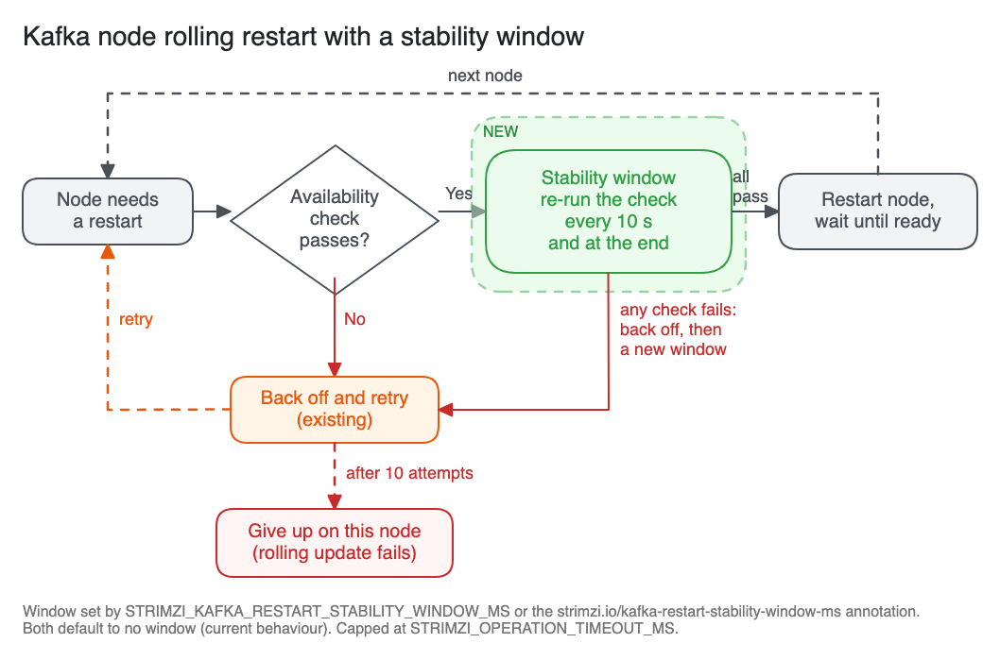

# Stability window between Kafka node restarts during rolling updates

This proposal adds an optional stability window to rolling updates of Kafka nodes.
Before the Cluster Operator restarts a node, the existing availability check has to pass and keep passing for the whole window, instead of passing once.
The window is a check before each restart, not a wait after one, and its purpose is to avoid restarting a node right after another node rejoined the in-sync replicas, while it is still unclear whether that node stays in them.
The window is set operator-wide with a new environment variable, `STRIMZI_KAFKA_RESTART_STABILITY_WINDOW_MS`, and overridden per cluster with a new annotation on the `Kafka` resource, `strimzi.io/kafka-restart-stability-window-ms`.
Both default to no window, so the current behaviour is unchanged unless a user opts in.

## Current situation

Rolling updates of Kafka nodes are performed by the `KafkaRoller`.
Before restarting a node, it checks that no partition with a replica on that node would drop below `min.insync.replicas` for brokers, and that the controller quorum would stay available for controllers.
If the check fails, the `KafkaRoller` retries it with an exponential backoff, and the rolling update fails when the retries are exhausted.
After a restart, it waits for the pod to become ready and moves on to the next node.

The availability check is a point-in-time check, so the next node is often restarted within seconds of the previously restarted node rejoining the in-sync replicas.

## Motivation

A node that has just rejoined the in-sync replicas can drop out again shortly afterwards, for example because of slow disks or log recovery that is still catching up.
If it drops out while the next node is down, partitions with replicas on both nodes fall below `min.insync.replicas`, for example with a replication factor of 3 and `min.insync.replicas=2`, and `acks=all` producers get `NOT_ENOUGH_REPLICAS`.

This happened during a Kubernetes node upgrade.
Two Kubernetes nodes, hosting brokers A and B, were drained at the same time, and the Strimzi Drain Cleaner annotated both pods for a restart.
The events were:

1. The `KafkaRoller` restarted A.
2. A became ready and rejoined the in-sync replicas of its partitions.
3. The availability check for B passed, because A was back in the in-sync replicas, and about 10 seconds later the `KafkaRoller` restarted B.
4. About 20 seconds after that, A stopped responding because of a slow disk, and the controller fenced it, which removed A from the in-sync replicas of all its partitions.
5. With A fenced and B restarting, partitions with replicas on both A and B fell below `min.insync.replicas`, and producers got `NOT_ENOUGH_REPLICAS` for a few minutes.

The availability check worked as designed: when it ran for B, A was in the in-sync replicas, and the check had no way to know that A would drop out 20 seconds later.

For example, with a stability window of 60 seconds, the `KafkaRoller` would have kept running the check for B after it first passed in step 3.
A check 30 to 40 seconds into the window would have failed because A was fenced, and B would have stayed up until A was back in the in-sync replicas.

The new `KafkaRoller` design in [PR #103 in strimzi/proposals](https://github.com/strimzi/proposals/pull/103), which was closed without being merged, included a fixed delay between restarts, `postRestartDelayMs`.
This proposal adds a similar setting to the existing `KafkaRoller`, but as a window over which the availability check has to keep passing instead of a fixed delay.

## Proposal

### Behaviour

When the effective window is greater than zero, the `KafkaRoller` handles each node that needs a restart as follows:

1. It runs the existing availability check for the node, as today.
2. When the check passes, it starts the window and runs the same check again at a fixed interval until the window ends.
3. If every check passes, including one at the end of the window, it restarts the node.
4. If any check fails, it treats it like a failed check today: it retries with the same backoff, and when the check passes again, it starts a new window from the beginning.

The two conditions for restarting a node are therefore that restarting it would not take any partition below `min.insync.replicas` or make the controller quorum unavailable, and that this has stayed true for the whole window.
The check covers every partition with a replica on the node about to be restarted, so the window also catches a replica on a third node dropping out, not only the previously restarted node.

### A check before each restart, not a wait after one

The window runs before each restart, as part of the decision to restart a node, and the `KafkaRoller` does not wait for anything extra after a restarted pod becomes ready.

In practice, the window still sits between restarts.
For the second and later nodes of a rolling update, when the partitions they share have no headroom above `min.insync.replicas`, for example a replication factor of 3 and `min.insync.replicas=2`, the check for the next node starts passing only when the previously restarted node is back in the in-sync replicas, because until then restarting another replica of those partitions would take them below `min.insync.replicas`.
The window therefore starts at the first check after the previous node has recovered, not when its pod became ready, so a node that is slow to catch up does not shorten it.

The first restart of a rolling update also waits for the window.
The window is evaluated from the live state of the cluster and nothing is stored between reconciliations, so a reconciliation that starts right after another one, or after a Cluster Operator restart, still waits for a full window.
A rolling update that restarts N nodes therefore waits for at least N windows, not N - 1.

### Check interval and scope

The check runs every 10 seconds and once more at the end of the window, or only at the end if the window is shorter than 10 seconds.
The interval is fixed and is not configurable, because each broker check describes all topics in the cluster, and a shorter interval would make the window expensive on clusters with many partitions.
A node that drops out of the in-sync replicas and rejoins between two checks is not detected.

The window applies to every restart that the availability check normally gates.
This includes, for example, restarts triggered by Kafka version upgrades and downgrades, configuration changes, CA renewals, the `strimzi.io/manual-rolling-update` annotation, and the Strimzi Drain Cleaner.
It does not apply when a node is only reconfigured without a restart, to restarts that already bypass the availability check, such as of a pod that is stuck or of a node that does not respond to the Kafka Admin API, or to restarts that the `KafkaRoller` forces after its retries are exhausted.
It does not cover pods deleted outside the Cluster Operator.

### Effect on reconciliations

Because a failed check uses the existing retries, a node that keeps dropping out exhausts them, and the rolling update fails for that node in the same way as when the availability check keeps failing today.

The reconciliation stays in progress during the window, and other reconciliations of the same `Kafka` resource cannot run until it ends.
Other `Kafka` clusters are not blocked, because each `KafkaRoller` uses its own thread.
Each restarted node adds at least the window to the duration of the rolling update, and a rolling update that started inside a maintenance time window can run past its end.
With the Strimzi Drain Cleaner, a node drain also takes longer, and drain timeouts in node-upgrade tooling need to allow for the window, because pods deleted directly when a drain times out are not covered by it.

### Upper limit

The window cannot be longer than `STRIMZI_OPERATION_TIMEOUT_MS`.
If the environment variable is set to a higher value, the Cluster Operator fails to start with a configuration error.
If the annotation is set to a higher value, the operator logs a warning and uses `STRIMZI_OPERATION_TIMEOUT_MS` as the window for that cluster.

A failed check during the window uses one of the existing retries, of which there are 10 per node, so a node waits at most about 10 windows plus the backoff delays of about 2 minutes before the rolling update fails.

### Environment variable `STRIMZI_KAFKA_RESTART_STABILITY_WINDOW_MS`

A new Cluster Operator environment variable sets the window for all Kafka clusters managed by the operator.

| Property | Value |
|:---------|:------|
| Name | `STRIMZI_KAFKA_RESTART_STABILITY_WINDOW_MS` |
| Type | Integer, milliseconds, `0` or less disables the window |
| Default | `0`, no window |
| Maximum | `STRIMZI_OPERATION_TIMEOUT_MS` |
| Scope | All `Kafka` clusters managed by the operator |

The name uses the `_MS` suffix like `STRIMZI_OPERATION_TIMEOUT_MS`, and includes `KAFKA` because it applies only to Kafka nodes.

An operator-wide setting fits the motivating case, where a Kubernetes node upgrade drains nodes under every cluster the operator manages.

### Annotation `strimzi.io/kafka-restart-stability-window-ms`

A new annotation on the `Kafka` resource overrides the operator-wide value for that cluster.

| Property | Value |
|:---------|:------|
| Name | `strimzi.io/kafka-restart-stability-window-ms` |
| Resource | `Kafka` |
| Type | Integer, milliseconds, `0` or less disables the window |
| Default | Unset, the environment variable applies |
| Maximum | `STRIMZI_OPERATION_TIMEOUT_MS` |

This lets users enable the window on the clusters where a restarted node needs time to stabilise, for example production clusters, and keep immediate restarts on others.

The annotation is read when the `KafkaRoller` is created, so a change during a rolling update takes effect from the next reconciliation.

### Precedence

The annotation, when set, overrides the environment variable for its cluster.
An annotation value of `0` or less disables the window for that cluster even if the environment variable is set.
If the annotation value is not an integer, the operator logs a warning and treats the annotation as not set.

### Implementation

- `ClusterOperatorConfig` gets a `KAFKA_RESTART_STABILITY_WINDOW_MS` parameter backed by the environment variable, validated against `STRIMZI_OPERATION_TIMEOUT_MS`.
- `ResourceAnnotations` in the `api` module gets an `ANNO_STRIMZI_IO_KAFKA_RESTART_STABILITY_WINDOW_MS` constant.
- `KafkaReconciler` and `CaReconciler`, the two places that create a `KafkaRoller`, resolve the effective window from the annotation with the environment variable as fallback, apply the cap, and pass it to the roller.
- `KafkaRoller` takes the window and a time source as constructor parameters.
  After the availability check has passed and a dynamic update is not possible or has failed, it runs the window before deleting the pod.
  Each check during the window reuses the existing availability check, `KafkaAvailability` for brokers and `KafkaQuorumCheck` for controllers, so the window adds no new check logic.
  The window runs synchronously on the roller's thread, like the wait for pod readiness, so it does not use up the retries of other nodes, such as the active controller waiting for the other controllers.
  It logs an `INFO` message when a window starts, when a check fails during it, and when it completes.
- A failed check during the window raises the same problem as a failed availability check today, so the existing retry and backoff handling applies unchanged.

The annotation can be implemented together with the environment variable or in a follow-up pull request.

## Testing strategy

The behaviour is covered by unit tests.
Timing-based system tests would be slow and prone to flakiness, so none are planned.

- `KafkaRollerTest`, with mocked availability and quorum checks that return a scripted sequence of results:
  - The check passes throughout, and the node is restarted after the window.
  - The check passes, fails, and passes again, and the window starts again from the beginning before the node is restarted.
  - The check keeps failing, and the rolling update fails after the existing retries, as it does today.
  - Reconfigurations without a restart and restarts of stuck or unresponsive pods do not wait for the window.
  - A dynamic update that fails falls back to a restart, and that restart waits for the window.
  - A force-roll after the retries are exhausted does not wait for the window.
  - The existing tests run with the window set to `0` and pass unchanged.
- `ClusterOperatorConfigTest` covers the environment variable, its default, and the validation against `STRIMZI_OPERATION_TIMEOUT_MS`.
- The `KafkaReconciler` and `CaReconciler` tests cover the annotation precedence, including `0`, invalid values, and values above the cap.

The window uses an injectable time source, so the tests do not depend on wall-clock timing.

## Affected/not affected projects

Only the Cluster Operator in `strimzi-kafka-operator` is affected.
The documentation of the Cluster Operator configuration and of the `Kafka` resource annotations is updated.
The Strimzi Drain Cleaner is not changed, since it only annotates pods and the window is applied by the `KafkaRoller`.
Kafka Connect and MirrorMaker 2 use a different roller and are not affected, nor are the HTTP Bridge, the Topic Operator, and the User Operator.

## Compatibility

The change is fully backwards compatible.
The environment variable defaults to `0` and the annotation is optional, so existing deployments behave as before.
A future replacement of the `KafkaRoller` can keep both settings with the same meaning.

## Rejected alternatives

### Fixed delay after a restarted node becomes ready

An earlier version of this proposal waited for a fixed time after a restarted pod became ready, then ran the availability check once.
If the node was still catching up when the delay ended, the next node was restarted as soon as it rejoined the in-sync replicas, with no time to show that it stays in them.
Since the check was not repeated during the delay, a node that dropped out and rejoined during it was not detected either.

### Checking only at the end of the window

The window could run the availability check only once, at its end, and start a new window if the check fails.
This shows only that the cluster is healthy when the window ends, not that it stayed healthy during it.
For example, with a window of 60 seconds, a previously restarted node that drops out of the in-sync replicas after 20 seconds and rejoins after 45 seconds passes the check, and the next node is restarted 15 seconds after the previous one rejoined.
A failed check would also have to wait for a full window before checking again, because retrying with the existing backoff would restart the next node as soon as the previous one rejoins, as happens today.
The only saving is fewer checks, and each check is served by the brokers from their metadata, while the existing backoff already repeats it more often than every 10 seconds on its first retries.

### Waiting only for the restarted node to stay in sync

The window could instead check only that the previously restarted node stays in the in-sync replicas.
Reusing the existing availability check is simpler and stricter, since it also covers other replicas of the partitions on the node about to be restarted.
