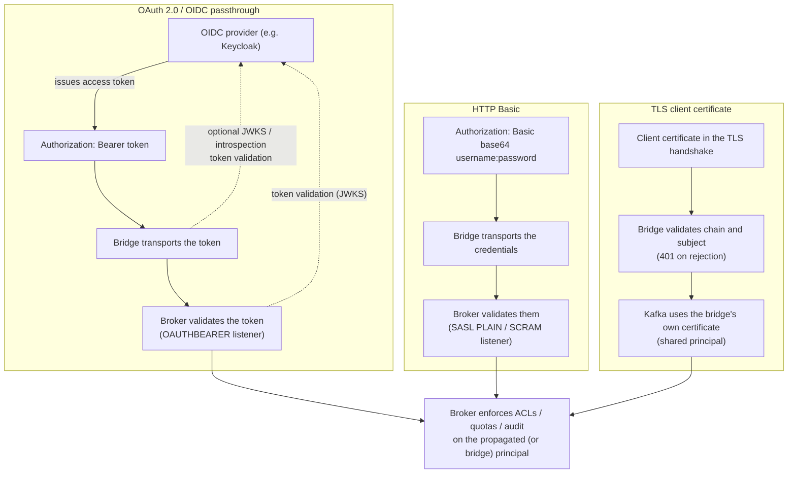
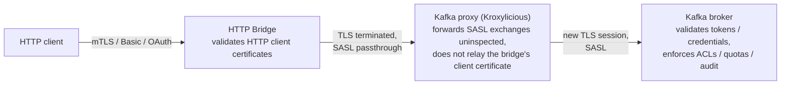

# HTTP Bridge authentication (OAuth, Basic and TLS client certificates)

This proposal adds authentication to the Strimzi HTTP Bridge in three parts.
HTTP clients can pass their OIDC access tokens or their username and password through the bridge to the Kafka cluster, so that the broker sees and authorizes the real caller's identity.
HTTP clients can also authenticate to the bridge itself with a TLS client certificate (mTLS).
Finally, the `KafkaBridge` custom resource in the operator gains the fields needed to configure all of this, since the bridge-side implementation already exists and only the operator integration is missing.

The bridge-side design of the authentication is documented in a separate design document.
This proposal summarizes that design and focuses on the Strimzi-wide view, in particular the `KafkaBridge` CRD evolution.

## Current situation

The HTTP Bridge lets HTTP clients use Kafka without the native Kafka protocol.
The bridge-to-broker leg can already be secured: the internal Kafka clients inherit all `kafka.*` properties, so `kafka.security.protocol`, `kafka.sasl.jaas.config` and the `kafka.ssl.*`/`kafka.sasl.*` options support SASL (PLAIN, SCRAM), TLS and even bridge-side OAuth through the Strimzi `kafka-oauth-client` library.
The operator's `KafkaBridge` resource already generates exactly this configuration for its existing `authentication` types (`tls`, `scram-sha-256`, `scram-sha-512`, `plain` and `custom`).
TLS encryption on the HTTP interface was added in [proposal 122](./122-enable-ssl-for-kafka-bridge.md).

What is missing is per-client and HTTP-driven authentication.
The gaps are:

* The bridge's Kafka credentials are static and bridge-wide.
* Every HTTP client shares the bridge's single identity, and nothing in an HTTP request can influence the credentials used for Kafka.
* Deployments needing per-client Kafka identities have to run one bridge deployment per identity.
* Because all requests hit Kafka with the bridge's identity, the broker cannot enforce per-client ACLs or quotas, and audit trails show the bridge instead of the real caller.
* HTTP Basic, the simplest and most widely implemented HTTP credential scheme, is unsupported.
* The bridge's HTTP interface itself is unauthenticated: anyone who can reach the bridge's port can produce to or consume from any topic, and only network-level controls (firewalls, reverse proxies) can restrict access.

There is also no `oauth` authentication type in the `KafkaBridge` CRD, unlike the `KafkaClientAuthenticationOAuth` type used by `KafkaConnect` and `KafkaMirrorMaker2`.

## Motivation

Enterprises standardizing on OIDC (Keycloak and similar providers) want the caller's access token to reach the broker, so that Kafka itself authorizes the original identity.
This enables multi-tenant deployments where one bridge serves many HTTP clients, each with its own principal, ACLs, quotas and audit trail at the broker.
Today this is only achievable by running one bridge deployment per identity, which multiplies deployments, credentials and operational burden.

HTTP Basic support unlocks straightforward integration of existing HTTP tooling (curl, SDKs, scripts) with SASL-secured clusters, since Basic is the default credential mechanism of most HTTP clients.
mTLS client certificate support secures the bridge's HTTP surface itself, authenticating clients to the bridge and restricting which certificates and subjects are accepted.

## Proposal

The solution extends the HTTP Bridge with three configurable, composable authentication methods, driven by a single `authentication.*` configuration namespace in `application.properties`.
The guiding principle is: **the bridge transports credentials, Kafka validates them - except TLS client certificates, which terminate at the bridge and are validated there.**



The OAuth and Basic flows propagate the HTTP client's identity to Kafka, so the broker authorizes the real caller.
The dashed arrows show the validation paths with the OIDC provider: with the bridge-side token validation enabled, the bridge checks the tokens against the provider (JWKS or introspection) before forwarding them, and the broker's OAUTHBEARER listener validates them against the provider as well.
The TLS client certificate flow authenticates the client to the bridge only, and the Kafka connection uses the bridge's own shared principal.
The client certificate method also composes with OAuth and Basic: mTLS at the bridge for transport security can be combined with per-client credentials passed through to the Kafka cluster.

Because Kafka clients are long-lived and a SASL/TLS connection authenticates only once, true per-request authentication is not possible with Kafka clients as-is.
The bridge therefore defines pragmatic credential semantics, described below.

### OIDC access token authentication

HTTP clients provide an OIDC access token in the `Authorization` header using the Bearer scheme (`Authorization: Bearer <access_token>`).
By default, the bridge does not validate the token: it uses the token as the OAUTHBEARER credential when connecting to the Kafka cluster, and the broker, configured with an OAUTHBEARER listener, is responsible for validating it.

Two modes are supported via `authentication.mode`:

* `passthrough` (default): the token provided by the HTTP client is forwarded to the Kafka cluster.
* `client-credentials`: the bridge obtains and refreshes tokens itself from the OIDC token endpoint using its own client id and secret, for deployments where per-client identity is not needed but the cluster requires OAuth.

The credential semantics for the long-lived Kafka clients are:

1. Producer requests: the producer authenticates with the token from the first request on the HTTP connection.
2. If a subsequent request on the same connection provides a different token, the internal producer is recreated with the new token.
3. Consumer requests: the consumer authenticates with the token from the request that created it (`POST /consumers/{groupid}`) and keeps it until the instance is deleted.
4. Admin requests: an admin client is created lazily and cached per access token in a bounded cache with idle eviction.

When the bridge-side token validation is enabled (`authentication.token.validation=jwks` or `introspection`), the bridge verifies the tokens before they are forwarded; the broker remains the authority for validating them.
With `jwks`, the bridge verifies the JWT signature against the provider's JWKS endpoint and checks the standard claims (expiry, not-before, optionally issuer and audience).
With `introspection`, the bridge checks token liveness against the RFC 7662 introspection endpoint, with results cached for a configurable period; this is the only mode in which revocation is detected before token expiry.
The endpoints can be configured directly or resolved automatically from the OIDC discovery document (RFC 8414).

#### Consumer credentials refresh

With short-lived access tokens, a long-lived consumer session outlives its pinned token, and the consumer group falls into rebalancing with poll errors until the instance is deleted and re-created with a fresh token.
The opt-in `authentication.consumer.credentials.refresh` option (default `false`) changes this.
When enabled together with the token validation, a subsequent request on the same consumer instance presenting a valid token of the same principal recreates the underlying Kafka consumer with the new credentials, preserving the subscription or assignment state.
The refresh only triggers when the pinned token is expired (including the tolerated clock skew) and the incoming token carries the same principal claim, so the session stays stable during normal token rotation.
The refresh is observable through the `strimzi_bridge_auth_consumer_credentials_refreshes_total` counter, since the recreation itself appears on the cluster only as a consumer group rebalance.

### HTTP Basic authentication

HTTP clients provide credentials in the `Authorization` header using the Basic scheme (`Authorization: Basic <base64-encoded username:password>`).
The bridge uses them as the SASL credential (PLAIN or SCRAM) when connecting to the Kafka cluster and does not validate them: the broker is responsible for that.
The credential semantics are the same as for the OAuth passthrough.

### TLS client certificate authentication

HTTP clients authenticate to the bridge itself by presenting a client certificate during the TLS handshake with the bridge HTTPS listener.
The listener gains a client authentication mode (`none`/`request`/`required`) and trusted CA configuration, so cert-less connections can be rejected at the handshake itself.
A root handler validates the peer certificate's subject against configurable regular expression patterns (`authentication.allowed.subjects`) before any request is processed, rejecting with `401 Unauthorized` otherwise.

A TLS client certificate authenticates the client to the bridge only.
The bridge does not hold the client's private key, so the certificate cannot be forwarded to Kafka, and the internal Kafka clients connect using the bridge's own certificate.
The method composes with OAuth and Basic: mTLS at the bridge can be combined with per-client credentials passed through to the Kafka cluster.

### Validation responsibilities

The validation work is split by the two trust boundaries the bridge terminates:

* The TLS layer is validated fully by the bridge, because it terminates the handshake: certificate chain, client auth enforcement, subject-based authorization and certificate validity period.
* By default, the `Authorization` header is validated syntactically only (header present and parseable, otherwise `401`): the broker, which owns the credentials, does the cryptographic validation.
* With the token validation enabled, the JWT is additionally verified against the OIDC provider (JWKS signature and claims check, or introspection) before it is forwarded, as a cheap pre-filter in front of the broker, which remains the authority.
* There is deliberately no switch to skip certificate validation; self-signed certificates are supported on every TLS surface through explicit trust instead.

### Bridge configuration and implementation

Everything is plain `application.properties`, so the Kubernetes integration needs no bridge-side changes: the operator generates the properties file.
The main new configuration keys are:

* `authentication.type=oauth|basic|client-cert` and `authentication.mode=passthrough|client-credentials`
* OAuth: `authentication.username.claim`, `authentication.token.validation`, `authentication.jwks.endpoint.uri`, `authentication.introspection.endpoint.uri`, `authentication.discovery.uri`, `authentication.consumer.credentials.refresh`, and the client-credentials options (`authentication.token.endpoint.uri`, `authentication.client.id`, `authentication.client.secret(.location)`, `authentication.scope`, `authentication.audience`)
* OIDC provider connection: `authentication.jwks.trusted.certificates(.location)`, `authentication.jwks.client.certificate(.location)` + `authentication.jwks.client.key(.location)`, and `authentication.proxy.*`
* Basic: optional `authentication.sasl.mechanism` (PLAIN, SCRAM-SHA-256, SCRAM-SHA-512)
* Client certificates: `http.ssl.client-auth`, `http.ssl.trusted.certificates(.location)` and `authentication.allowed.subjects`

Credentials are extracted per request and carried as immutable objects through the routing context, with tokens and passwords masked in logs and `toString()`.
A misconfigured token validation or TLS material fails the bridge fast at startup.
The implementation reuses libraries already on the classpath wherever possible (nimbus-jose-jwt for JWT/JWK handling, Guava for the replay and admin caches, Jackson for claim parsing), adding only one new direct dependency (`com.nimbusds:oauth2-oidc-sdk`, used for the RFC 8414 discovery document parsing).
Authentication is observable through Micrometer metrics for the rejected authentications, the JWKS/introspection/discovery interactions, the DPoP validation outcomes and the internal caches.

The bridge-side implementation is complete, including unit and integration tests against Keycloak-backed Kafka clusters and JaCoCo coverage measurement.

### `KafkaBridge` CRD changes

The remaining work is in the operator repository, where the `KafkaBridge` CRD cannot express the authentication configuration yet.

#### OAuth authentication type

An `oauth` type is added to `spec.authentication`, following the existing `KafkaClientAuthenticationOAuth` naming conventions:

```yaml
              authentication:
                type: object
                properties:
                  # ... existing properties (certificateAndKey, username, passwordSecret, sasl, config) ...
                  type:
                    type: string
                    enum:
                    - tls
                    - scram-sha-256
                    - scram-sha-512
                    - plain
                    - custom
                    - oauth                       # NEW
                    description: "Specifies the authentication type. ... `oauth` configures OIDC
                      access token authentication using the Strimzi OAuth client."
                  mode:                           # NEW
                    type: string
                    enum:
                    - passthrough
                    - client-credentials
                    description: "Specifies how the bridge obtains OIDC access tokens.
                      `passthrough` forwards the access token provided by HTTP clients in the
                      Authorization header to the Kafka cluster. The Kafka cluster is responsible
                      for validating the tokens. Required with `type: oauth`."
                  usernameClaim:                  # NEW
                    type: string
                    description: "JWT claim to use as the identity of the access token. The default
                      is `sub`. Must match the `userNameClaim` configured on the Kafka cluster's
                      OAuth listener."
                  groupsClaim:                    # NEW (optional, matches listener option)
                    type: string
                x-kubernetes-validations:         # NEW: mutual exclusion rules
                - rule: "self.type != 'oauth' || has(self.mode)"
                  message: "mode property is required with type oauth"
                - rule: "self.type != 'oauth' || (!has(self.username) && !has(self.passwordSecret) &&
                    !has(self.certificateAndKey) && !has(self.sasl))"
                  message: "username, passwordSecret, certificateAndKey and sasl cannot be set
                    with type oauth"
```

Adding an enum value and new optional properties is backward-compatible.
The CEL validation rules give users clear errors instead of misconfiguration at runtime.

An example custom resource:

```yaml
apiVersion: kafka.strimzi.io/v1
kind: KafkaBridge
metadata:
  name: my-bridge
spec:
  replicas: 1
  bootstrapServers: my-cluster-kafka-bootstrap:9093
  tls:
    trustedCertificates:
      - secretName: my-cluster-cluster-ca-cert
        certificate: ca.crt
  authentication:
    type: oauth
    mode: passthrough
    usernameClaim: preferred_username   # must match the listener's userNameClaim
  http:
    port: 8080
```

In `KafkaBridgeCluster` (operator model), the auth handling is a pure properties mapping, since the operator writes the bridge's `application.properties` into a ConfigMap mounted at `custom-config/`:

| CR field | Generated `application.properties` entry |
|---|---|
| `authentication.type: oauth` + `mode: passthrough` | `authentication.type=oauth` |
| `authentication.mode: client-credentials` | `authentication.mode=client-credentials` |
| `authentication.usernameClaim` | `authentication.username.claim=<claim>` (only when set) |
| `authentication.clientId` / `clientSecret` / `tokenEndpointUri` | `authentication.client.id` / `authentication.client.secret(.location)` / `authentication.token.endpoint.uri` |
| (always, for oauth) | `kafka.security.protocol=SASL_SSL` |
| (always, for oauth) | `kafka.sasl.mechanism=OAUTHBEARER` |
| `spec.tls` (optional) | existing `kafka.ssl.truststore.*` handling, unchanged |

The `clientSecret` is mounted from a `Secret`, so the generated configuration uses `authentication.client.secret.location`.

#### HTTP Basic authentication

No CRD change is needed.
The existing `plain`, `scram-sha-256` and `scram-sha-512` authentication types (username + `passwordSecret`) are mapped to `authentication.type=basic` (plus the optional `authentication.sasl.mechanism`) in the generated `application.properties`, so the credentials provided by HTTP clients in the `Authorization` header are passed through to the Kafka cluster.

#### TLS client certificate authentication

TLS client certificate authentication is TLS-level configuration of the HTTP listener rather than Kafka client authentication, so it belongs in the `spec.http` section:

```yaml
  http:
    port: 8080
    clientAuth: required                  # NEW: none (default) | request | required
    clientTrustedCertificates:            # NEW: CAs for validating the client certificates
      - secretName: my-client-ca
        certificate: ca.crt
    allowedSubjects:                      # NEW: regex patterns for the accepted certificate subjects
      - "CN=my-user.*"
```

The operator maps these to `http.ssl.client-auth`, `http.ssl.trusted.certificates.location` and `authentication.allowed.subjects` in the generated `application.properties`.
The Kafka connection keeps using the bridge's own certificate through the existing `spec.tls` / `spec.authentication` (`type: tls` with `certificateAndKey`) handling.

#### Bridge-side token validation, provider mTLS and proxy

The remaining bridge-side keys (`authentication.token.validation`, `authentication.discovery.uri`, `authentication.jwks.client.certificate(.location)` / `authentication.jwks.client.key(.location)`, `authentication.jwks.trusted.certificates(.location)`, `authentication.proxy.*`, `authentication.consumer.credentials.refresh`, ...) also need first-class CRD fields.
The existing `type: custom` cannot carry them, because the CRD restricts its `config` property to `sasl.` / `ssl.keystore.` prefixes.

### Broker-side consistency

The broker is the authority for validating the tokens and credentials, so the `Kafka` CR listener must be configured to match:

* OAuth: the listener must be configured with `type: oauth` and the matching `userNameClaim` / `groupsClaim` / `validIssuerUri` / `jwksExpirySeconds`, since the broker validates the token.
* Basic: the listener must use the matching SASL mechanism (`type: scram-sha-512`, `type: plain`, ...) or `type: tls` with SASL over SSL, since the broker validates the credentials.
* Client certificates: the client certificates are validated by the bridge itself, and the Kafka listener must trust the bridge's certificate (`type: tls` on both sides).

### Proxy considerations (Kroxylicious)

The authentication methods are compatible with a Kafka proxy such as [Kroxylicious](https://kroxylicious.io/) between the bridge and the Kafka cluster.
The design keeps working unchanged in that topology:

* SASL passthrough is the default behavior: Kroxylicious forwards the `SaslHandshake`/`SaslAuthenticate` exchanges to the broker without inspecting them, so the OAUTHBEARER and PLAIN/SCRAM credentials passed through by the bridge reach the broker and are validated by it.
* Broker-side ACLs, quotas and audit logging therefore work exactly as if the bridge connected directly.
* TLS is terminated on both sides: the bridge's truststore must trust the proxy's virtual cluster gateway certificate (valid for the proxy's bootstrap address) instead of the cluster CA.
* The bridge's Kafka client certificate does not reach the broker ([kroxylicious#1637](https://github.com/kroxylicious/kroxylicious/issues/1637)): if the Kafka listener requires `ssl.client.auth=required`, the proxy must present its own upstream client certificate that the broker trusts; otherwise the bridge needs no Kafka-side keystore when going through the proxy.
* The HTTP-side TLS client certificate authentication is unaffected: the `client-cert` type authenticates HTTP clients to the bridge HTTPS listener, and the proxy is not in that path.



The proxy can also compose with the bridge's authentication.
With the `SaslInspection` or `OauthBearerValidation` filters, it extracts (or pre-validates) the identity from the very OAUTHBEARER/SCRAM exchanges produced by the bridge's passthrough, enabling identity-aware filters (Authorization, EntityIsolation) and rejecting invalid tokens before they reach the broker.

### Deploying on Kubernetes

Every secret and certificate on the bridge side is configured through a file location (`authentication.client.secret.location`, `authentication.jwks.trusted.certificates.location`, `http.ssl.trusted.certificates.location`, ...), so the material is mounted from Kubernetes `Secret`s and never appears inline in a `ConfigMap`.
Until the operator-side work lands, the bridge image already supports all the authentication features when deployed as a plain `Deployment` with a ConfigMap for `application.properties` and `Secret` volume mounts for the sensitive material.

### Authorization (future extension)

Authorization is the natural next step, but out of scope for this proposal.
With OAuth/Basic passthrough, broker-level authorization already works, because the broker sees the real per-client principal and enforces its ACLs.
The gap exists only where the principal is shared (client-cert, client-credentials mode).
Since the bridge already extracts an authenticated identity per request (certificate subject, Basic username, OAuth principal claim), a bridge-level RBAC extension mapping identity to allowed operations and resources can be added later as a new `authorization.*` configuration namespace, enforced at the HTTP routing layer before any Kafka client is created.

### Testing and documentation

* The bridge-side implementation is covered by unit and integration tests, including end-to-end tests against Keycloak-backed Kafka clusters (passthrough, client-credentials, JWKS and introspection validation, discovery, DPoP, consumer credentials refresh, Basic and client-cert), with assertions on the rejected-authentications metrics.
* New system tests in `strimzi-kafka-operator` will deploy `KafkaBridge` resources with the new `oauth` type and the new `spec.http` fields, and verify that the generated bridge configuration authenticates against secured clusters.
* The bridge documentation gains procedures for configuring the OAuth, Basic and client-certificate authentication, and the operator documentation gains the new `KafkaBridge` API options and examples.

## Affected/not affected projects

* strimzi-kafka-bridge - authentication implementation already done, documentation drafted
* [strimzi-kafka-operator](http://github.com/strimzi/strimzi-kafka-operator/) - `KafkaBridge` CRD and model changes, system tests
* All other projects are not affected.

## Compatibility

* The CRD changes are backward-compatible: adding an enum value and new optional properties does not affect existing resources.
* The existing `authentication` types keep their current semantics.
* The bridge-side `authentication.*` properties are new and default to no authentication, so existing deployments behave unchanged.
* The consumer credentials refresh is opt-in (default `false`), so the default consumer behavior (credentials pinned at creation) is unchanged.
* The operator maps the existing `plain` / `scram-sha-256` / `scram-sha-512` types to `authentication.type=basic`; the same CRs continue to work with the bridge versions that only support the static `kafka.*` credential configuration, so no upgrade ordering constraint is introduced beyond the usual bridge/operator compatibility matrix.

## Rejected alternatives

### Header-based per-client certificate passthrough to Kafka

The bridge could accept each client's certificate and private key via HTTP headers and present that client's certificate to Kafka, giving true per-client principals with zero extra auth code.
This was rejected because private keys would travel through the bridge on every request (a serious security liability), each distinct client certificate would force Kafka connection churn and full TLS handshakes, and HTTP clients would have to manage X.509 key material, which is unusual for REST consumers.

### SASL termination at the bridge (bridge as authenticator)

The bridge could validate credentials itself against the OIDC provider or an LDAP backend and connect to Kafka with a single bridge service account.
This was rejected because Kafka would see only the bridge principal, losing per-client ACLs, quotas and audit at the broker, and the bridge would need validation infrastructure and share trust decisions with the broker.
The client-credentials OAuth mode covers this use case as an option rather than the main path.

### HTTP reverse proxy / API gateway in front of the bridge

An API gateway is a legitimate solution for the HTTP side, but with no authentication implemented in the bridge, identity injection is lost downstream (the bridge has no mechanism to consume forwarded identity headers), the Kafka principal remains a single shared one, per-client authorization degrades to coarse gateway-level route rules, and the bridge port must be locked down to the gateway.
The passthrough design makes a gateway additive rather than required: a gateway forwarding the `Authorization` header untouched keeps working.
Scaling out bridges (one deployment per tenant with its own static credentials) remains a viable pre-existing pattern, but identity granularity is per tenant, not per end user.

### Kafka delegation tokens per client

Delegation tokens are a native Kafka mechanism, but issuing them requires Kerberos or broker-side delegation-token authentication as the bootstrap mechanism, a heavy prerequisite rarely present in OIDC-based stacks, and there is no OAuth integration.

### Network controls only

Relying on network policies plus a single bridge principal requires zero code, but provides no defense in depth, no per-client authorization and no identity propagation, so it does not solve the problem for multi-tenant use.

### Interim relaxation of `type: custom`

Users could get close to the OAuth support today with `type: custom` plus `kafka.sasl.mechanism=OAUTHBEARER`, but the CRD restricts that to `sasl.` / `ssl.keystore.` property prefixes, so the bridge-side `authentication.*` properties could not be set.
Relaxing the prefix restriction was considered as an interim option, but a first-class `oauth` type is the right design and avoids a CRD change that would later have to be deprecated.
