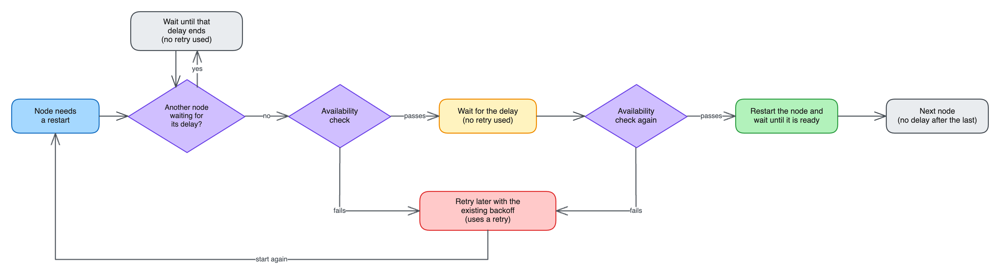

# Delay between Kafka node restarts during rolling updates

This proposal adds an optional delay to rolling updates of Kafka nodes.
With the delay enabled, the Cluster Operator restarts a node only after the existing availability check has passed, the delay has elapsed, and the check has passed once more.
Its purpose is to avoid restarting a node right after another node rejoined the in-sync replicas, while it is still unclear whether that node stays in them.
The delay is set operator-wide with a new environment variable, `STRIMZI_POST_KAFKA_RESTART_DELAY_MS`, and overridden per cluster with a new annotation on the `Kafka` resource, `strimzi.io/post-kafka-restart-delay-ms`.
Both default to no delay, so the current behaviour is unchanged unless a user opts in.

## Current situation

Rolling updates of Kafka nodes are performed by the `KafkaRoller`.
Before restarting a node, it checks that no partition with a replica on that node would drop below `min.insync.replicas` for brokers, and that the controller quorum would stay available for controllers.
If the check fails, the `KafkaRoller` retries it with an exponential backoff, and the rolling update fails when the retries are exhausted.
After a restart, it waits for the pod to become ready and moves on to the next node.

The availability check is a point-in-time check, so the next node is often restarted within seconds of the previously restarted node rejoining the in-sync replicas.

## Motivation

A node that has just rejoined the in-sync replicas can drop out again shortly afterwards, for example because of slow disks or log recovery that is still catching up.
If it drops out while the next node is down, partitions with replicas on both nodes fall below `min.insync.replicas`, for example with a replication factor of 3 and `min.insync.replicas=2`, and `acks=all` producers get `NOT_ENOUGH_REPLICAS`.

This happened during a Kubernetes node upgrade.
Two Kubernetes nodes, hosting brokers A and B, were drained at the same time, and the Strimzi Drain Cleaner annotated both pods for a restart.
The events were:

1. The `KafkaRoller` restarted A.
2. A became ready and rejoined the in-sync replicas of its partitions.
3. About 10 seconds after A rejoined, the availability check for B passed, because A was back in the in-sync replicas, and the `KafkaRoller` restarted B.
4. About 20 seconds after that, A stopped responding because of a slow disk, and the controller fenced it, which removed A from the in-sync replicas of all its partitions.
5. With A fenced and B restarting, partitions with replicas on both A and B fell below `min.insync.replicas`, and producers got `NOT_ENOUGH_REPLICAS` for a few minutes.

With a 60-second delay, the check for B would still have passed in step 3, but it would have started the delay instead.
A was fenced about 30 seconds after it rejoined, so the check at the end would have failed, and B would have stayed up.

The new `KafkaRoller` design in [PR #103 in strimzi/proposals](https://github.com/strimzi/proposals/pull/103), which was closed without being merged, included a delay between restarts, `postRestartDelayMs`.
This proposal adds a similar setting to the existing `KafkaRoller`.

## Proposal

### Behaviour

When the effective delay is greater than zero, the `KafkaRoller` handles each node that needs a restart as follows:

1. It runs the existing availability check for the node, as today.
2. When the check passes, it does not restart the node yet, but starts the delay.
3. When the delay ends, it runs the check once more and restarts the node if it passes.
4. If the check fails, it treats it like a failed check today: it retries with the same backoff, and when the check passes again, it starts a new delay from the beginning.

The check covers every partition with a replica on the node about to be restarted, so the check at the end also catches a replica on a third node that dropped out during the delay, not only the previously restarted node.
A node that drops out of the in-sync replicas and rejoins within the delay is not detected.

### Where the delay sits

In practice, the delay still sits between restarts.
When the partitions shared by the previous and the next node have no headroom above `min.insync.replicas`, the next node's check only passes once the previous node is back in the in-sync replicas, so the delay starts when the previous node has recovered, not when its pod became ready.

Only one node waits for its own delay at a time.
Other nodes that need a restart or a reconfiguration wait for that delay to end before their own check runs.

Because the delay comes before each restart rather than after it, nothing waits after the last restart, and a restart in a later reconciliation or after a Cluster Operator restart is delayed too, without storing anything between reconciliations.
The cost is that the first restart also waits, because the `KafkaRoller` cannot tell whether a node has just rejoined the in-sync replicas, so a rolling update that restarts N nodes waits for at least N delays.

### Scope

The delay applies to every restart that the availability check normally gates, for example for Kafka upgrades and downgrades, configuration changes, CA renewals, the `strimzi.io/manual-rolling-update` annotation, and the Strimzi Drain Cleaner.
A dynamic reconfiguration gets no delay of its own but waits for a pending delay of another node, and if it fails, the fallback restart waits for the delay.

The delay does not apply to restarts that bypass the check, such as of a stuck pod or of a node that does not respond to the Kafka Admin API, or to a force-roll after the retries are exhausted, which still requires the check to pass.
These restarts do not wait for a pending delay of another node either; the check at the end of that delay catches their effect.
Pods deleted outside the Cluster Operator are not covered.

### Effect on reconciliations

Each failed check at the end of the delay uses one of the existing 10 attempts, so a node waits for at most about 10 delays plus about 2 minutes of backoff before the rolling update fails as it does today.

The reconciliation stays in progress during the delay, so other reconciliations of the same `Kafka` resource cannot run until it ends, but other clusters are not blocked, because each `KafkaRoller` has its own thread.
Each restart adds at least the delay to a rolling update, which can then run past the end of a maintenance time window, and node drains with the Drain Cleaner take longer.
Drain timeouts in node-upgrade tooling must allow for the delay, because pods deleted directly when a drain times out are not covered.

### Upper limit

The delay cannot be longer than `STRIMZI_OPERATION_TIMEOUT_MS`.
This keeps a mistyped value, such as `60000000` instead of `60000`, from holding a reconciliation for hours.
If the environment variable is set to a higher value, the Cluster Operator fails to start with a configuration error.
If the annotation is set to a higher value, the operator logs a warning and uses `STRIMZI_OPERATION_TIMEOUT_MS` as the delay for that cluster.

### Environment variable `STRIMZI_POST_KAFKA_RESTART_DELAY_MS`

| Property | Value |
|:---------|:------|
| Name | `STRIMZI_POST_KAFKA_RESTART_DELAY_MS` |
| Type | Integer, milliseconds, `0` or less disables the delay |
| Default | `0`, no delay |
| Maximum | `STRIMZI_OPERATION_TIMEOUT_MS` |
| Scope | All `Kafka` clusters managed by the operator |

The name uses the `_MS` suffix like `STRIMZI_OPERATION_TIMEOUT_MS`, and includes `KAFKA` because it applies only to Kafka nodes.
An operator-wide setting fits the motivating case, where a Kubernetes node upgrade drains nodes under every cluster the operator manages.

### Annotation `strimzi.io/post-kafka-restart-delay-ms`

| Property | Value |
|:---------|:------|
| Name | `strimzi.io/post-kafka-restart-delay-ms` |
| Resource | `Kafka` |
| Type | Integer, milliseconds, `0` or less disables the delay |
| Default | Unset, the environment variable applies |
| Maximum | `STRIMZI_OPERATION_TIMEOUT_MS` |

This lets users enable the delay on the clusters where a restarted node needs time to stabilise, for example production clusters, and keep immediate restarts on others.

The name mirrors the environment variable and keeps `kafka`, because the annotation is on the `Kafka` resource but applies only to its Kafka nodes.

The annotation is read when the `KafkaRoller` is created, so a change during a rolling update takes effect from the next reconciliation.

### Precedence

| Environment variable | Annotation | Effective delay for the cluster |
|:---------------------|:-----------|:--------------------------------|
| Not set | Not set | None, current behaviour |
| Set | Not set | The environment variable value |
| Not set | Set | The annotation value |
| Set | Set | The annotation value, including `0`, which disables the delay for that cluster |

If the annotation value is not an integer, the operator logs a warning and treats the annotation as not set.

### Implementation

- `ClusterOperatorConfig` adds a `POST_KAFKA_RESTART_DELAY_MS` parameter for the environment variable, validated against `STRIMZI_OPERATION_TIMEOUT_MS`.
- `ResourceAnnotations` in the `api` module adds an `ANNO_STRIMZI_IO_POST_KAFKA_RESTART_DELAY_MS` constant.
- `KafkaReconciler` and `CaReconciler`, the two places that create a `KafkaRoller`, resolve the effective delay, apply the cap, and pass it to the `KafkaRoller` constructor.
- When the check for a node passes, the `KafkaRoller` reschedules the node on its executor for the end of its delay, without sleeping on the roller's thread.
  If the check at the end fails, the existing retry and backoff handling applies.
- Other nodes that need a restart or a reconfiguration are rescheduled to the end of a pending delay, before the existing deferral of the active controller.
- Neither kind of rescheduling calls the backoff, so no node, including the active controller, uses up retries while it waits.
- A failed dynamic update is recorded, so that the node is restarted after its delay without trying the dynamic update again.
- An `INFO` message is logged when a delay starts, when the check at its end fails, and when the node is restarted.

The environment variable is implemented in [PR #13212 in strimzi-kafka-operator](https://github.com/strimzi/strimzi-kafka-operator/pull/13212), which will be updated to this behaviour, and the annotation is added in the same release.

## Testing strategy

The behaviour is covered by unit tests, since timing-based system tests would be slow and prone to flakiness.

- `KafkaRollerTest`, with scripted results for the availability and quorum checks and a short delay, covers that:
  - The node is restarted after the delay when the check passes at both ends, and when the check at the end fails, a new delay starts only after the check passes again.
  - The rolling update fails after the existing retries when the check keeps failing.
  - Each delay starts after the previous restart, and no delay follows the last restart.
  - Waiting for its own delay or for another node's uses up no retries, including those of an active controller that only needs a reconfiguration.
  - Reconfigurations wait only for a pending delay of another node, and restarts of stuck or unresponsive pods and force-rolls do not wait for any delay.
  - A failed dynamic update falls back to a delayed restart, without trying the dynamic update again.
  - The existing tests pass unchanged with the delay set to `0`.
- `ClusterOperatorConfigTest` covers the environment variable, its default, and the cap.
- The `KafkaReconciler` and `CaReconciler` tests cover the annotation precedence, including `0`, invalid values, and values above the cap.

## Affected/not affected projects

Only the Cluster Operator in `strimzi-kafka-operator` is affected.
The documentation of the Cluster Operator configuration and of the `Kafka` resource annotations is updated.
The Strimzi Drain Cleaner is not changed, since it only annotates pods and the delay is applied by the `KafkaRoller`.
Kafka Connect and MirrorMaker 2 use a different roller and are not affected, nor are the HTTP Bridge, the Topic Operator, and the User Operator.

## Compatibility

The change is fully backwards compatible, since both settings default to no delay.
A future replacement of the `KafkaRoller` can keep both settings with the same meaning.

## Rejected alternatives

### Fixed delay after a restarted node becomes ready

The first version of this proposal, and the current version of PR #13212, wait for a fixed time after a restarted pod becomes ready, then run the availability check for the next node once.
If the restarted node is still catching up when the delay ends, the next node is restarted as soon as it rejoins the in-sync replicas.
It also has to wait after the last restart, to cover a next restart in a later reconciliation.

### Stability window between Kafka node restarts during rolling updates

The previous version of this proposal required the availability check to keep passing for a whole window, checking every 10 seconds, and started a new window whenever a check failed.
It catches a node that drops out for more than 10 seconds and rejoins within the window, but each check is still a point-in-time check, so a node that drops out and rejoins between two checks is missed too.
In exchange, it needs window state, a polling loop, and a describe call every 10 seconds, which is expensive on clusters with many partitions.
