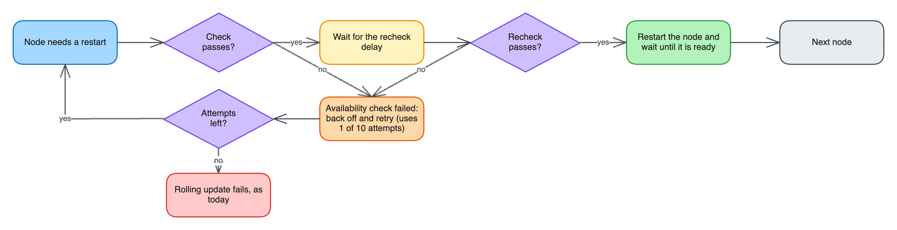

# Availability recheck delay for Kafka node restarts

This proposal adds an optional recheck to the availability check that the Cluster Operator runs before restarting a Kafka node.
With a recheck delay set, the check has to pass, and pass again after the delay, before the node is restarted.
This avoids restarting a node while another node that has just rejoined the in-sync replicas might still drop out.
The delay is set with a Cluster Operator environment variable or a `Kafka` resource annotation, and is off by default.

## Current situation

The `KafkaRoller` performs rolling updates of Kafka nodes, one node at a time, on a thread of its own.
Before a restart, it checks that no partition with a replica on the node would drop below `min.insync.replicas`, and for a controller, that the quorum would stay available.
If the check fails, it retries with an exponential backoff, and the rolling update fails after 10 attempts.
After a restart, it waits for the pod to become ready and moves on to the next node.
A ready pod means that the broker is running, not that it is back in the in-sync replicas.

The check is a point-in-time check, so the next node is often restarted within seconds of the previous node rejoining the in-sync replicas.

## Motivation

A node that has just rejoined the in-sync replicas can drop out again shortly afterwards, for example because of a slow disk.
If it drops out while the next node is down, partitions with replicas on both nodes fall below `min.insync.replicas`, and producers using `acks=all` get `NOT_ENOUGH_REPLICAS`.

This happened during a Kubernetes node upgrade, on a cluster with a replication factor of 3 and `min.insync.replicas=2`.
Two Kubernetes nodes hosting brokers A and B were drained at the same time, and the Strimzi Drain Cleaner annotated both pods for a restart:

1. The `KafkaRoller` restarted A.
2. A became ready and rejoined the in-sync replicas.
3. About 10 seconds later, the check for B passed, because A was back in the in-sync replicas, and the `KafkaRoller` restarted B.
4. About 20 seconds after that, A stopped responding because of a slow disk, and the controller fenced it.
5. With A fenced and B restarting, partitions with replicas on both fell below `min.insync.replicas`, and producers failed for a few minutes.

With a 60-second recheck delay, the recheck for B would have run after A was fenced, and B would have stayed up.

## Proposal

### Behaviour

With a recheck delay greater than zero, the availability check works as follows:

1. It runs the existing check, as today.
2. If the check passes, it waits for the recheck delay.
3. It runs the existing check again.
4. If both pass, the node is restarted as today.

If either check fails, the availability check fails, and the `KafkaRoller` retries with the existing backoff, starting again from the first check.

The recheck covers the same partitions as the first check, so it fails if a replica on another node dropped out during the wait.
Controllers recheck the quorum, and nodes with both roles recheck both.
A replica that drops out and rejoins within the wait is not detected.

### When it waits

The wait is part of the check, so no state is kept, and only one node waits at a time.

Each restart comes at least one delay after the previous node became ready, which also spaces out the leadership changes that clients see.
Some partitions may have replicas on both nodes and a replication factor of `min.insync.replicas` + 1, as in the incident.
For them, the first check fails until the previous node rejoins the in-sync replicas.
The wait then starts only once that node has rejoined.

The first restart of a rolling update waits too, because the check cannot tell whether a node has just rejoined.
Nothing waits after the last restart, and a restart in a later reconciliation, or after the Cluster Operator restarts, is rechecked the same way.

The check always passes for a single controller and for partitions whose replication factor is not above `min.insync.replicas`.
For those, the recheck adds only the delay.

### Scope

The recheck applies to every normal restart, such as for upgrades, configuration changes, CA renewals, and the Strimzi Drain Cleaner.

A node that only needs a dynamic reconfiguration keeps the single check, because a reconfiguration does not take the node offline.
If the dynamic update fails and the node is restarted instead, it is rechecked before the restart.

Restarts that skip the check today are not delayed, such as those of stuck pods and of nodes that do not respond to the Kafka Admin API.
Force-rolls after the retries are exhausted keep the single check.
Pods deleted outside the Cluster Operator are not covered.

### Effect on reconciliations

A failed recheck uses one of the 10 attempts.
If the recheck keeps failing, a node waits for 10 delays plus about 2 minutes of backoff before the rolling update fails, instead of about 2 minutes today.

The wait blocks the cluster's `KafkaRoller` thread, as waiting for pod readiness already does.
This thread is not a Vert.x thread, and a non-blocking wait would let the `KafkaRoller` restart another node during the wait.
The `Kafka` resource stays locked meanwhile, so its other reconciliations are retried later, and other clusters are not affected.
Pausing reconciliation does not interrupt a wait that has started, as for any step of a rolling update.
Drain timeouts must allow for one delay per restart, because a drain tool that deletes a pod after its own timeout skips the check.

### Configuration

| Property | Environment variable | Annotation |
|:---------|:---------------------|:-----------|
| Name | `STRIMZI_KAFKA_AVAILABILITY_RECHECK_DELAY_MS` | `strimzi.io/kafka-availability-recheck-delay-ms` |
| Set on | Cluster Operator | `Kafka` resource |
| Applies to | All `Kafka` clusters | That cluster |
| Value | Milliseconds, default `0` | Milliseconds, unset by default |

The annotation overrides the environment variable, and a value of `0` or less disables the recheck.
An annotation value that is not an integer is ignored with a warning.
A change to the annotation applies from the next reconciliation.

The delay cannot be longer than `STRIMZI_OPERATION_TIMEOUT_MS`, so a mistyped value cannot hold a reconciliation for hours.
A higher environment variable stops the Cluster Operator from starting, and a higher annotation is capped with a warning.

The names follow `STRIMZI_OPERATION_TIMEOUT_MS`, and include `kafka` because they apply only to Kafka nodes.
The environment variable suits node upgrades, which drain nodes under every cluster, and the annotation enables the recheck only where needed.

### Implementation

- `ClusterOperatorConfig` adds the environment variable, validated against `STRIMZI_OPERATION_TIMEOUT_MS`.
- `ResourceAnnotations` in the `api` module adds the annotation.
- `KafkaReconciler` and `CaReconciler`, which create the `KafkaRoller`, resolve the delay and pass it to its constructor.
- In `KafkaRoller.restartIfNecessary`, the `canRoll` call checks, waits, and checks again when the node needs a restart.
  The `canRoll` call before a force-roll is unchanged.
  Each check keeps its existing 60-second timeout, so the delay does not count against it.
  If the Cluster Operator stops during the wait, the node is not restarted, and the next reconciliation starts again from the first check.
- If the node only needs a dynamic reconfiguration, `canRoll` runs a single check, and a fallback restart is rechecked.
- The `KafkaRoller` logs at `INFO` level when it starts a wait and when a recheck fails.

The environment variable is implemented in [PR #13212 in strimzi-kafka-operator](https://github.com/strimzi/strimzi-kafka-operator/pull/13212), which will be updated to this design.

## Testing strategy

Unit tests cover the behaviour, since timing-based system tests would be slow and flaky.

- `KafkaRollerTest` scripts the check results through `TestingKafkaRoller`, which already overrides `availability` and `quorumCheck`.
  It also overrides the wait, so that no test sleeps, and covers that:
  - A node is restarted only when both checks pass, and a failed recheck retries from the first check.
  - The rolling update fails after 10 attempts when the recheck keeps failing.
  - A dynamic reconfiguration does not wait, and its fallback restart is rechecked.
  - Restarts of stuck or unresponsive pods and force-rolls do not wait.
  - The existing tests pass unchanged with no delay.
- `ClusterOperatorConfigTest` covers the environment variable, its default, and the cap.
- The `KafkaReconciler` and `CaReconciler` tests cover the annotation override, `0`, invalid values, and the cap.

## Affected/not affected projects

Only the Cluster Operator is affected, and its documentation is updated.
The Strimzi Drain Cleaner is unchanged, since it only annotates pods.
Kafka Connect and MirrorMaker 2 use a different roller and are not affected.

## Compatibility

The change is backwards compatible, since both settings default to no delay.

## Rejected alternatives

### Fixed delay after a restarted node becomes ready

PR #13212 currently waits a fixed time after a restarted pod becomes ready, then checks the next node once.
The closed [PR #103 in strimzi/proposals](https://github.com/strimzi/proposals/pull/103) for a new `KafkaRoller` proposed the same as `postRestartDelayMs`.
It is the simplest option, and it would have prevented the incident above.
But a busy broker can take longer than the delay to catch up and rejoin the in-sync replicas.
The next check then passes as soon as it rejoins, and the next node is restarted with no wait.
The recheck starts its wait only when the check first passes, so it covers this case too.
A fixed delay also has to follow the last restart, to cover a restart in a later reconciliation.
Both options add one wait to the `KafkaRoller` thread, so the implementation cost is similar.

### Delay outside the availability check

Rescheduling the node for the end of the delay would avoid blocking the `KafkaRoller` thread.
For the same behaviour, it has to track pending delays across nodes and failed dynamic updates.
Since the `KafkaRoller` handles one node at a time anyway, a wait inside the check is simpler.

### Stability window

The check has to keep passing for a whole window, checked every 10 seconds.
Unlike the recheck, it also catches a replica that drops out and rejoins during the window, if it stays out for more than 10 seconds.
In exchange, it needs window state, a polling loop, and a describe call every 10 seconds, which is expensive on clusters with many partitions.

### Field in the `Kafka` resource

A field would get schema validation, but it is an API change for a setting that most clusters leave disabled.
The annotation can become a field later if it is widely used.
